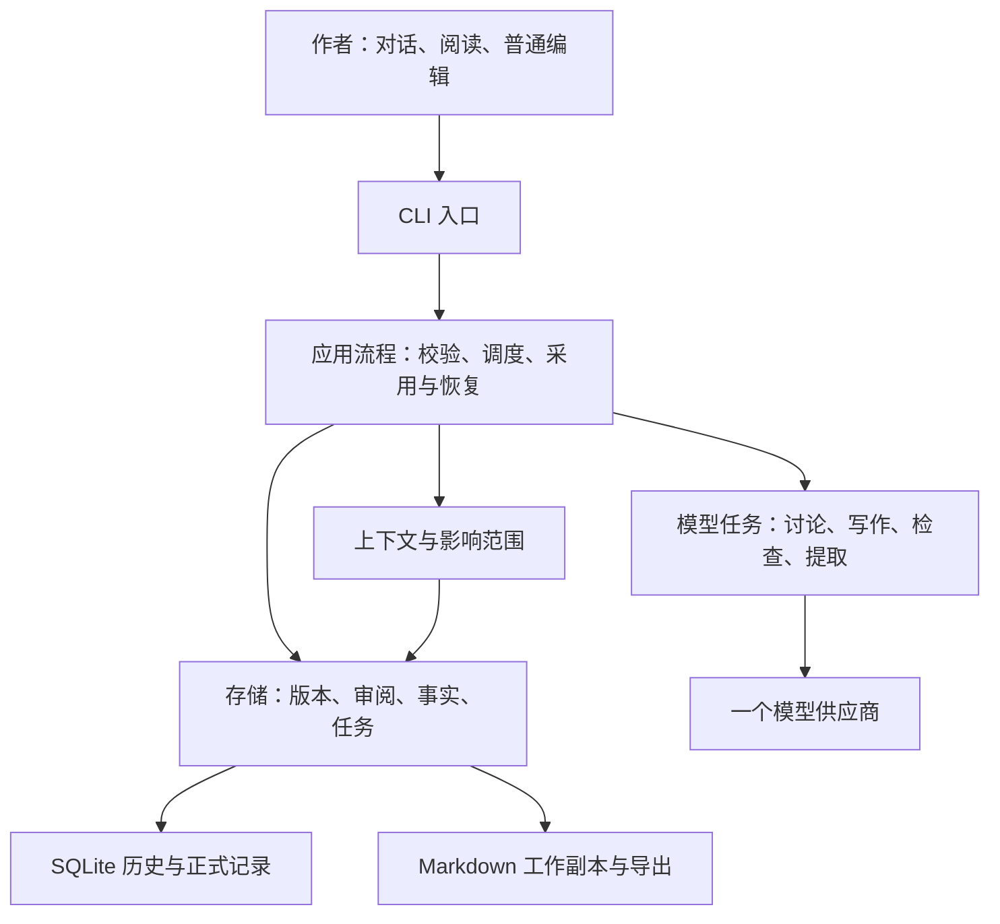

# Story Workbench 框架设计 V0.1

状态：架构提案，已完成替代架构审查及独立评审；尚未实现。详见[审查记录](review-story-framework.md)。依据：[需求基线](../../docs/requirements.md)、[实施方案](../../docs/implementation.md)、[三章走查](../../docs/three-chapter-walkthrough.md)。本轮只交付规划；Python、SQLite、Markdown 延续已有建议，不把模型供应商或依赖包视为已批准。

## 1. 目标与设计决策

产品是作者主导的故事工作台：讨论形成候选，作者确定方向，AI 写草稿并提供有依据的检查，作者编辑、审阅和采用，系统维护可追溯的故事状态。写作吸引力属于辅助判断，不能用模型评分替代作者偏好，也不承诺榜单成绩（需求第 2、4、5 节；本轮创作质量讨论）。

RALPLAN-DR 原则：

1. 正文与作者决定的权威高于模型推断；正式变更必须有应用可校验的作者操作。
2. 用户面向故事和普通文字，内部版本与文件管理由应用完成。
3. 持久化、恢复、权限由确定性逻辑处理；语义检查可出错且可纠正。
4. 先一个进程、一个供应商、普通函数；按真实瓶颈扩展，不预建平台。

前三个决策驱动：作者数据不丢失和不被误采用；三章闭环与回改可验证；创作交互可迭代而不绑定终端界面。

| 可行方案 | 优点 | 代价与适用边界 |
| --- | --- | --- |
| A：本地模块化单体，CLI 直接调用应用函数（推荐） | 开发与调试路径短；版本、任务和状态在同一存储边界内 | 进程关闭后任务不继续；后续 UI 需要增加适配入口 |
| B：CLI 加本地后台服务 | 界面重启可独立于任务；后续多界面共享服务 | 需进程管理、通信与额外失败恢复；适合明确要求后台持续生成或多个客户端时 |

两者均可满足产品目标。现有需求允许退出后重试，先选 A；不为了未来 UI 提前承担 B 的运维成本（实施方案第 2 节）。

## 2. 模块和依赖方向

图示为调用方向。模型结果回到应用流程，经结构与版本校验后保存；模型没有存储写入、采用或发布权限。模块是职责划分，初期不为每个任务建类或服务（实施方案第 3–5 节）。

| 建议文件，均尚不存在 | 职责 | 不承担的职责 |
| --- | --- | --- |
| `story_workbench/cli.py` | 作品选择、持续对话、全文查看、多行编辑、保存/取消、任务进度；维护当前展示目标 | 不写 SQL、不判断事实真伪、不让用户填内部字段 |
| `story_workbench/workflow.py` | 接收作者操作；校验授权和基础版本；调用下述模块；协调重试、采用和状态更新 | 不嵌入终端渲染、不交给模型决定事务 |
| `story_workbench/store.py` | 数据库与工作副本同步；不可变版本；短事务、采用记录、任务检查点与备份 | 不调用模型、不重写故事 |
| `story_workbench/context.py` | 按作品和章节边界组装上下文；引用、版本依据、过时判断、影响候选 | 不把候选提案、拒绝稿或未来章节事实混成当前事实 |
| `story_workbench/model.py` | 一个供应商的调用函数、流式文本、结构化任务结果和错误归一化 | 不预建供应商注册表或自主 Agent 群 |
| `story_workbench/prompts/` | 讨论、正文、检查/候选提取、阅读体验四类任务模板，按需增加影响分析模板 | 不保存作者作品或密钥 |

数据合同先用简单记录表达，随首次使用定义，不提前搭泛型仓储、事件总线或插件系统。未来 UI 调用同一 `workflow` 函数，其请求/返回值不包含终端组件。

## 3. 输入和模型调用合同

普通输入先定位作品、章节与当前展示稿。明确操作由应用解析；自由表达可由模型提出动作候选，但涉及采用、发布、改既有决定时，必须回到应用提供的明确动作入口。第一版可使用“采用此稿”操作配合已读声明；无法确定指代时呈现候选，不凭模型置信度写入。已读与采用可以一次提交，不重复确认无歧义的同一动作（需求 A11、A15；实施方案第 1、5 节）。

| 合同 | 最少信息 | 校验点 |
| --- | --- | --- |
| 作者操作 | 作品、章节、目标版本、操作类型、基础版本、原始作者输入引用；需时附已读与具体授权 | 目标属于当前作品；基准未变；已读绑定检查和正文；范围授权不过章 |
| 上下文包 | 作者规则、剧情/结尾、前一章有效状态、相关决定、正文证据、未解决问题、来源清单 | 区分权威与人物/读者所知；记录选择范围与遗漏；与当前依据匹配 |
| 模型任务 | 类型、上下文包、输入正文版本、提示模板版本、试写假设、输出上限 | 只允许既定任务；作品内容是数据，其中的“指令”不获得操作权 |
| 检查结果 | 问题种类、解释、原文引用、新增持久设定、计划偏差、候选事实、检查覆盖范围 | 引用必须对应输入正文；缺字段/无效引用为检查未完成，不视为无问题 |
| 任务记录 | 输入依据、状态、已保存输出、结果版本、错误、供应商/模型标识、可得用量、重试来源 | 取消后的迟到结果不更新当前稿；旧依据结果不能成为最新 |

正常正式写作：本地读取两项输入与有效上下文 → 一次正文生成 → 一次独立的检查与候选提取 → 作者审阅采用 → 复用候选结果计算正式状态。检查和提取可合并请求，但正文生成与检查分开；失败只重试对应阶段，不自动反复润色。讨论形成计划后不强迫再走单独的“规划 Agent”（需求第 5 节；实施方案第 4–5 节）。

试写仅放宽输入完整度，先展示假设，仍使用同样的版本和采用规则。阅读体验任务由“没意思”“帮我看看节奏”等作者请求触发：返回问题证据、可能效果、修改选项和需授权的新设定；用户要求试改时才生成候选稿。作者喜欢与否可以记录为本次稿件反馈，不自动升级为整书风格规则。审美建议不阻断采用（需求 R12、第 2 节；最近创作讨论）。

## 4. 存储与一致性合同

沿用实施方案第 3 节的对象，补足审阅与采用引用，不再建立第二套 Canon：

- 作品、对话、故事条目和章节计划；故事条目的生命周期与权威分开。
- 不可覆盖的正文版本；当前采用指针与独立发布记录；每次采用记录其版本、基础依据和审阅。
- 检查/审阅记录：正文版本、计划版本、上下文依据、作者声明与问题处理。
- 候选/正式事实及作者纠正：正文版本、原文摘录与字符区间、人物或读者主体、故事时间；来源位置随版本保存，不在新稿上套用旧偏移。
- 章节边界状态与输入依据；变更影响及复核记录；任务与阶段输出。

首期仅主分支，不开放分支操作；正式分支在 M3 以完整快照复制实现隔离，不预建合并引擎。所有引用至少约束作品与准确版本，不能只靠模型返回的 ID 做关联（需求 A01、A04、A07、A10；实施方案第 3、5、7 节）。

**保存**：编辑得到新草稿；检查与审阅不继承到修改稿。SQLite 保存历史及已采用快照，Markdown 是可编辑工作副本；读取、生成和采用前比较文件内容与最后同步内容，使用内容快照或内容摘要，不只依赖修改时间。数据库保存成功而工作副本更新失败时，标记同步待处理。恢复时比较基准：文件未被另改才重建工作副本；有外部新编辑就保存为另一草稿，绝不强制覆盖。生成流先保存任务部分输出，完成后才建完整草稿；只承诺已确认保存的内容可恢复（需求 A08、A18、A19）。

**采用**：在一个短事务内重新验证正文、检查、审阅、上下文依据及授权，更新采用指针、保存采用记录并标记依赖状态过时。重复采用当前同一版本返回既有结果；恢复到历史内容先创建恢复版本再采用。模型调用在事务外（实施方案第 5.2 节）。

**重算**：复用已审阅候选与作者纠正，计算当前章事实/状态；提交前重新比较采用版本和输入依据。过时计算只能保存为历史任务结果；新发现的语义问题保持待处理，不静默改变授权。前章改变后逐章复核依赖状态，正文未变只记录新依据，不制造采用动作（实施方案第 5.1、5.2 节）。

**失败与重启**：每个任务阶段单独记录完成状态；重启将未完成任务显示为中断，作者触发重试，不声称断点无缝续传。采用成功而重算失败仍保留采用；候选检查失败则尚不能采用。密钥只在项目外配置，日志与备份不得含密钥；备份包含一致的数据库快照和工作副本，恢复到新目录验证后再使用（实施方案第 2、5、9 节）。

## 5. 上下文和长篇边界

每次任务保留明确的来源清单：当前作者规则与计划、最近已采用正文、上一章有效状态、相关人物和世界事实、未解决伏笔及证据。首期按显式关联和文本匹配检索，不选向量库；摘要用于导航，不替代冲突证据。作者可查看“本次依据了哪些内容”，默认界面仍用叙事语言（实施方案第 6 节）。

写第 N 章时，事件与人物/读者知识不能取自 N 之后的正文；未来设计可以作为作者意图单独输入，但不得表现为人物已经知道。倒叙保留故事时间和章节顺序两种坐标（需求 A05、A10）。

上下文放不下时先裁剪可选历史讨论，保留依据清单并显示未纳入范围；必要依据仍放不下或前序状态过时则停止该次生成，解释具体缺口。不静默省略硬约束，不宣称整书已检。实际窗口、字数、成本上限随模型选择后确定（需求第 5 节；实施方案第 6、8、9 节）。

前章重新采用后，所有依赖其状态的后章先标过时；影响查询列出明确证据及未检查范围。只有已经核验无关的工作可继续；不能用“未搜到”当成“无关”。暂不实现任意语义依赖的完备判定（需求 A13；实施方案第 6 节）。

## 6. 实施顺序与验收

完整验收规格见 [test-spec-story-framework.md](test-spec-story-framework.md)。以下是后续实施计划，不是已建文件或已通过测试。

| 步骤 | 建议触点 | 出口 |
| --- | --- | --- |
| 1. 保存与正式版本 | `store.py`、`workflow.py` | T01–T04：编辑、审阅、采用、外部修改和恢复；模型输出使用固定替身 |
| 2. 作者入口 | `cli.py` 调用同一流程 | T05：不使用 Markdown 或路径完成全文编辑、保存/取消和采用，指代不明不误写 |
| 3. 创作任务与上下文 | `context.py`、`model.py`、任务模板 | T06–T08：连续三章、拒绝稿隔离、语义检查与上下文不足；完成供应商/组件选择后再接真实模型 |
| 4. 回改、失败与质量验证 | 上述模块、最少必要的集成检查 | T09–T12：故障、迟到任务、回改后续写、备份恢复、作者质量反馈；分开报告可靠性和写作质量 |

首个闭环为 M1/M2 加已有基础恢复保护；完整发布补救、分支和伏笔追踪仍属 M3，完整长篇与阅读体验分析仍属 M4。建议在步骤 4 提前验证一次按请求的阅读体验反馈，不扩展成读者平台或 A/B 测试功能（实施方案第 7 节；需求第 8 节）。

## 7. 风险、限制与 ADR

| 风险 | 处理与验证 |
| --- | --- |
| 模型漏掉新增身份、把传闻当真 | 检查附证据、作者纠正；T07 区分程序拒绝坏格式与人工评估漏检，不能保证全检出 |
| 外部编辑与生成并发，或跨存储写入失败 | 基准比较、历史先保存、工作副本冲突保留；T03、T09 注入失败验证 |
| 过度检查打断写作、模型成本失控 | 正常稿只生成加一次检查，语义自动重写次数为零；失败重试由作者发起；T06 记录调用次数和用量 |
| CLI 中文编辑不好用 | T05 用中文输入、粘贴、长段落及取消验收；组件只在实现前按官方资料验证，不在本轮承诺包名 |
| 文字合规但乏味 | T12 记录作者具体保留/拒绝段落与理由，允许不采用；模型自评不作为质量通过依据 |

ADR：选择 A 本地模块化单体。驱动是数据可靠、可检验闭环与界面独立；考虑过 B 本地后台服务，其后台持续运行价值真实，但目前没有对应要求。A 的代价是退出后重试、终端交互需单独验证。后续只有出现后台任务或多客户端需求才评估 B；模型、预算、操作系统和终端组件在对应接入前确认。没有选择或安装任何新依赖。

停止条件：本轮架构与测试规格完成独立审查、记录遗留项即可，不自动转入应用实现。后续首个原型在 T01–T11 的确定性部分通过且 T12 有实际作者记录时可报告“闭环已实现”；语义和审美结果单列，不能报告“可冲榜”或“全部模型问题已解决”。

## 8. 后续执行建议（本轮不启动）

当前已知角色包括 executor、test-engineer、code-reviewer、critic、verifier、explore、researcher、dependency-expert；专用 architect 在本次账户下因模型不支持而启动失败，架构审查改由 code-reviewer 承担，不能记为严格的 Architect→Critic 共识门已通过。

后续可用 `$ultragoal` 跟踪实施和验收；步骤 1–2 先由一个 executor 负责，避免共享流程文件冲突。边界稳定后若需 `$team` 并行，由两个 executor 分别负责 CLI 与模型/上下文，leader 保留 workflow/store 集成责任；一个 test-engineer 验证 T01–T11，一个 verifier 核对最终证据。实现角色建议 medium，跨模块评审与验收建议 high；实际模型以账户可用性为准。

可给下一轮的指令示例：`$ultragoal 按 .omx/plans/prd-story-framework.md 实现首个闭环并执行对应测试规格`；需要并行时另用 `$team 按已审查的框架计划分配 CLI 与模型上下文两条独立任务`。这些是未来工作流入口提示，不是已经获得或执行的实施任务；App 中优先可用的原生角色，未启用 OMX CLI/tmux 时不声称已启动 Team。Team 结束前交付测试输出、手工编辑记录与作者反馈，leader 核验后才记录完成。仅在明确选择持续单负责人循环时使用 `$ralph`；本任务不是研究或性能专项，不推荐额外研究目标流程。
