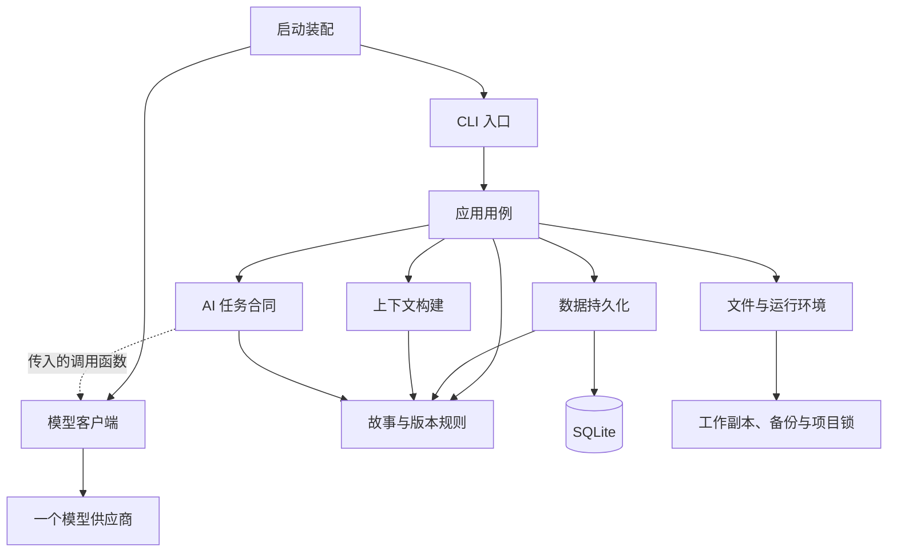
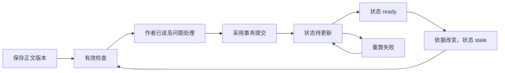
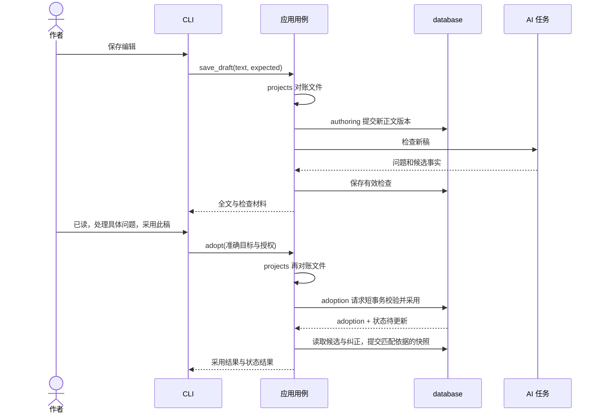

# 代码架构设计 V0.2

日期：2026-09-10，状态更新 2026-09-11。状态：首期代码已按本文实现，`story_workbench/` 的包结构、数据表、命名提交函数与测试文件与第 2、3、4、10 节对应；实现中的偏差与补充见第 12 节。

依据：[需求基线](requirements.md)、[实施方案](implementation.md)、[三章走查](three-chapter-walkthrough.md)、[框架提案](../.omx/plans/prd-story-framework.md)和[验收规格](../.omx/plans/test-spec-story-framework.md)。本文细化实现合同；不扩大首期范围，也不将既有替代架构审查记为严格 Ralplan 共识门通过。

## 1. 范围与实现决策

技术选择及其状态见[技术选型](technology-decisions.md)。其中资料查阅和自主审稿为待细化扩展方向，不改变本文首期数据与执行合同。

首期交付本地、单作者、主分支的 CLI 创作闭环，包含版本恢复、失败重试和前章回改后的状态保护。M3 已补充分支、发布补救、影响分析和伏笔追踪的本地闭环；长篇质量评估按原里程碑推进。

设计原则：作者操作决定正式变更；不可变记录保存依据；模型不控制事务；先用普通函数和标准库。决策驱动依次为不丢稿、不误采用、能按章节追溯上下文。

| 决策 | 选择与代价 | 替代方案及启用条件 |
| --- | --- | --- |
| 运行结构 | 单进程直接调用；退出后任务中断 | 后台服务在确需关掉界面仍持续生成时再评估 |
| 数据权威 | SQLite 保存历史，Markdown 是工作副本；需要明确同步协议 | 正文全以文件为权威会增加版本和采用跨文件协调，本期不选 |
| 代码组织 | 函数模块；共享数据记录随首次使用增加 | 不建通用仓储、事件总线、供应商注册表 |
| 并发 | 每个项目一次运行一个应用写入进程；允许外部编辑 | 多客户端支持需重新设计工作副本协调，SQLite 写事务不能替代文件协调 |
| 检索 | 明确引用、章节边界、文本匹配 | 在样本证明遗漏或成本问题后评估向量检索 |

建议 Python 3.11+，首轮在当前 macOS 环境验证；跨平台终端体验不预先声称通过。模型供应商、具体模型、预算和终端编辑组件在接入前选择，不作为数据层开工前提。

2026-09-10 工具选择确认：Python 包、依赖锁定和项目环境统一使用 uv，测试使用 pytest。初始化时创建 `pyproject.toml` 和 `uv.lock`，将 pytest 列为开发依赖并提交锁文件；环境目录 `.venv/` 不入库。统一测试命令为 `uv run pytest`。这替代先前 unittest 方案；当前只记录选择，工具链尚未初始化。

## 2. 逻辑职责、依赖与代码组织

逻辑模块按业务责任、数据所有权和变化原因划分；Python 文件与包只是承载方式，不要求一个逻辑模块对应一个文件，也不按表或模型角色逐一建类。

### 2.1 职责与副作用边界

| 逻辑职责 | 拥有的规则或流程 | 允许的副作用 / 不承担的责任 |
| --- | --- | --- |
| 交互入口 | 输入编辑、当前展示目标、已读声明和具体授权收集 | 只调用应用用例；不写 SQL、不调用模型客户端 |
| 应用用例 | 讨论与设计、写作与检查、采用与复核、项目恢复；决定阶段顺序 | 协调数据库、文件和任务；不自行重写业务判定，也不解析供应商协议 |
| 故事与版本规则 | 采用条件、版本和依据有效性、权限范围、事实语义、状态计算 | 纯函数，输入完整记录、输出判定或计算结果；不读文件、数据库、网络、时钟 |
| AI 任务 | 讨论、写作、检查、阅读反馈的模板、输入输出合同及校验 | 只通过传入的客户端调用函数请求模型；不控制 run、采用或恢复 |
| 上下文构建 | 章节过滤、来源选择、摘录、容量分配与遗漏清单 | 输入候选来源记录，输出上下文草案；不自行查询数据库或调用模型 |
| 数据持久化 | 读模型、SQL、关系约束、短事务、schema 迁移 | 拥有数据库读写；提交时用最新记录调用同一套业务规则；不写工作文件或调用模型 |
| 文件与运行环境 | 工作副本读取、独立文件写入、项目锁、备份文件校验 | 文件 I/O；不自行更新正文/采用表，数据库快照由应用请求持久化模块提供 |
| 模型客户端 | 单个供应商的协议、认证、超时、流和网络错误 | 网络 I/O；不理解采用和 Canon，不执行模型提出的动作 |

应用用例调用具体持久化函数即可，不为单个 SQLite 实现另建通用 Repository 接口。规则纯函数可同时供用例预检和数据库事务内复核调用，避免出现两套授权判断。依赖方向不靠给每一层添加抽象类实现。



图中实线为调用依赖，虚线是启动时注入的客户端函数。模型响应和文件观察值沿调用栈返回应用，由应用决定是否保存。规则与上下文不反向依赖应用；持久化不导入应用；任务不导入具体供应商。只有启动入口装配客户端、项目资源和 CLI；不用服务定位器或依赖注入容器。

### 2.2 按需落地的包结构

以下是职责落点，不是开工时必须创建的空目录清单。随着对应功能实施创建文件，`__init__.py` 只作包标识，不藏启动或数据库连接副作用。

```text
story_workbench/
  __main__.py                参数、资源装配、退出与清理
  cli.py                     首期终端交互；编辑复杂后再拆包
  application/
    authoring.py             讨论、决定、计划、正文编辑及历史恢复
    generation.py            上下文读取、任务阶段、流保存、检查与取消
    adoption.py              审阅采用、事实纠正、复核与状态重算
    projects.py              项目生命周期、文件对账、备份及重启恢复
  domain/
    records.py               故事记录、动作、结果与 WorkbenchError
    rules.py                 纯校验与状态计算；首次使用时定义
  ai/
    context.py               纯上下文选择与容量分配
    tasks.py                 四类任务函数、输出解析及校验
    prompts/                 与任务合同一起维护的模板
  infrastructure/
    database.py              SQLite 查询、命名提交函数、迁移
    files.py                 文件观察、独立写入、锁及备份文件处理
    provider.py              一个供应商的客户端函数
tests/                       仓库根目录，与包同级
  test_adoption.py            采用与版本的集成流程
  test_generation.py          任务、上下文与迟到结果流程
  test_recovery.py            文件、重启、备份与恢复流程
```

跨层都需要的故事记录放 domain；AI 请求/响应记录属于 ai/tasks，文件观察值属于 infrastructure/files，用例专有参数与结果就近定义。不得把供应商 DTO、数据库行或所有配置塞进一个共享 records 文件。

拆分条件是出现独立变化或测试边界，例如数据库 schema 迁移变复杂后拆 `infrastructure/migrations/`，规则中的权限与事实计算独立演进后再拆文件。文件长度可以提示问题，但不能代替职责判断。首个采用切片只需其用例、领域记录/规则、数据库及最小验证；不先创建网络客户端或全部任务文件。

### 2.3 数据所有权与事务责任

| 数据组 | 唯一业务写入口 | 数据库提交责任 |
| --- | --- | --- |
| message、story_item、plan、version、当前编辑稿 | authoring；生成结果由 generation 提交，外部导入由 projects 协调 | database 保存不可变版本和准确指针；共享保存函数避免不同来源有不同保护规则 |
| basis/source、run、check/issue/candidate | generation | database 保存任务阶段及通过校验的结果；ai/tasks 不写这些表 |
| review/resolution/adoption、fact_revision/head、snapshot、impact | adoption | database 在短事务中重读依据，复用 domain/rules 校验并原子提交 |
| workcopy 同步元数据 | projects.reconcile_workcopy | files 返回观察值，database 保存导入版本及同步基准；没有跨文件系统原子事务 |

“业务写入口”按用例拥有；物理数据库写入统一在 database。应用间仅有单向调用：generation/adoption/authoring 可调用 projects 的文件对账，generation 的阶段重试可调用 adoption 的纯重算用例；projects 不反调这些用例，数据库与文件恢复通过命名持久化操作完成。检查与采用分两次用户可见操作，adoption 不反向调用 generation，避免循环。

事务所有者是 database 的命名提交函数：应用先准备输入，提交函数开始事务、加载当前事实、调用纯规则、写入、提交或回滚。普通纯规则调用不等于已提交授权。文件读取和网络请求不得放进数据库事务。不会让上层通过多个独立 commit 拼出一次采用，也不引入通用 UnitOfWork 框架。

## 3. 数据约定与关系

每个小说项目有独立数据库，仍在关系中保留 `novel_id`，拒绝来自另一个打开项目的 ID。ID 使用应用生成的 UUID 字符串；时间用 UTC；正文保存原始 Unicode 内容，证据偏移按 Python 字符索引 `[start, end)`，不按 UTF-8 字节或终端显示宽度。换行归一化只发生在明确保存入口，检查必须引用保存后的确切正文。

下表是需要实现的最小逻辑表合同。共有字段：所有表有 `id`、`created_at`；除 novel 外均有 `novel_id`。历史表只插入；列出的当前指针、任务进度和同步状态允许更新。可选引用用 NULL，JSON 仅放非关系载荷，不能把需外键校验的业务引用藏进 JSON。

| 表 | 核心字段（除共有字段） | 约束与作用 |
| --- | --- | --- |
| novel | title, design_revision | 一库一作品；规则用 story_item 表达并保留历史；决定/规则变动递增 design_revision |
| message | role, body, chapter_id? | 保留作者、模型原文；角色枚举，不执行正文中的指令 |
| story_item | logical_id, revision, kind, body, authority, lifecycle, source_message_id, supersedes_id?, chapter_id?（v2） | logical_id + revision 在作品内唯一；authority 与 lifecycle 分开；决定、拒绝、归档均追加修订 |
| chapter | number, current_plan_id?, current_draft_id?, adopted_id?, current_snapshot_id?, needs_review | number 在作品内唯一且大于零；current_draft 指向同章版本，正文草稿不决定采用指针 |
| plan | chapter_id, revision, plot?, ending?, source_message_id | 修订不可变；正式写作要求两项非空，试写允许缺失 |
| version | chapter_id, parent_id?, restored_from_id?, body, content_hash, origin, run_id? | 不可覆盖；origin 为 author/generated/external/restore；parent 与恢复来源必须同章 |
| workcopy | chapter_id, relative_path, base_version_id?, base_hash?, observed_version_id?, sync_status | 每章一行；记录最后同步基准与当前观察稿；路径由应用生成 |
| basis | chapter_id, plan_id?, previous_snapshot_id?, design_revision, purpose, omitted_sources_json | 某次任务所用的不可变依据；第一章可无前章状态；设计修订号可检测新加入的规则 |
| basis_source | basis_id, version_id?, story_item_id?, snapshot_id?, fact_revision_id?, message_id?, role, excerpt_start?, excerpt_end?, quote | 每行恰有一个来源引用；文本来源保留区间和准确摘录，结构化状态保存实际发送的确定性序列化文本；role 区分规则、事实、作者意图、讨论 |
| run | chapter_id?, task, basis_id?, input_version_id?, source_message_id, retry_of_id?, status, partial_text, result_version_id?, provider?, model?, template_version, request_json, usage_json?, error_code? | request_json 保存缺口、假设、输出限制与 delegation_scope；scope 本期仅允许本次请求本章，不能授权改决定或采用；阶段独立建记录；同一生成 run 最多一个完整结果版本 |
| check_result | chapter_id, version_id, basis_id, run_id, coverage_json, actual_plot, actual_ending | 只保存校验有效的完整结果；失败保留在 run；结尾和剧情是候选解释 |
| issue | check_id, kind, explanation, proposed_change | 问题在保存后不可变；关系证据单独保存 |
| issue_evidence | issue_id, version_id?, basis_source_id?, start?, end?, quote | 来源二选一；必须是该检查正文或同一 basis 的来源；文本区间必须匹配原文 |
| candidate_fact | check_id, kind, subject?, proposition, story_time?, evidence_start, evidence_end, quote | 绑定检查的正文；kind 为 world/character_belief/reader_information/narration/uncertain |
| review | chapter_id, version_id, check_id, basis_id, author_message_id, read_declared, accepted_plot, accepted_ending | 全文已读不能由滚动推断；实际剧情和结尾需明确接受，尤其试写和计划偏离 |
| resolution | review_id, issue_id, action, author_message_id, explanation, decision_revision_id?, fact_revision_id? | 每个问题最多一个处理；纠正提取时引用本次具体修订；新增设定/变更决定需具体授权，普通已读不替代 |
| adoption | chapter_id, version_id, review_id, previous_adoption_id?, request_id | 同一作品 request_id 唯一；chapter 指向当前 adoption；同一版本可有不同历史复核依据 |
| fact_revision | candidate_id, previous_revision_id?, kind, subject?, proposition, story_time?, evidence_start, evidence_end, quote, author_message_id | 作者纠正追加记录，保留原提取；证据仍属于原正文版本 |
| fact_head | candidate_id, current_revision_id | 每个候选最多一行，修订必须属于该候选；比较预期 head 后原子更新，不按时间猜有效修订 |
| snapshot | chapter_id, adoption_id, check_id, review_id, basis_id, previous_snapshot_id?, status, error_code? | 章节边界的全量事实快照；候选→ready/failed/stale；只将匹配当前依据的 ready 记录设为当前 |
| snapshot_fact | snapshot_id, candidate_id?, fact_revision_id? | 二选一；继承前章事实并加入本章事实及纠正；可追溯来源采用记录 |
| impact | chapter_id, old_snapshot_id?, source_adoption_id?, source_story_item_id?, reason, evidence_issue_id?, status, resolved_review_id? | 来源采用或决定修订二选一；证据复用 issue_evidence；未知影响可无证据但必须说明范围；pending/resolved |

M3 增加 `publication`、`publication_divergence`、`branch`、`remediation_plan`、`impact_analysis` 与 `foreshadow_event`。发布限制目标为准确的已采用版本和 ready 快照；发布记录只追加，本地后续采用不移动其指针，也不表示外部平台同步。发布正文、发布时快照和补救计划进入独立的读者历史分区，补救计划明确保持为未成为正文事实。分支从 adopted ready 快照 fork，先 staging，应用层完成隔离目录物化后由 database 命名函数标为 ready。

没有“已采用事实”布尔字段：正式事实由当前有效 snapshot 的成员关系决定。被拒绝或未采用稿的候选不能直接加入 snapshot；snapshot_fact 的正文来源必须属于该快照对应的有效采用链。正文含糊时保存 uncertain 或角色认知，不推导世界真相。

### 3.1 数据库强制约束

- 每次连接开启外键校验；关系使用作品及章节范围的复合外键，例如 version 的 `UNIQUE(novel_id, chapter_id, id)`，adoption 的目标引用完整三元组。
- review 的 version、basis 必须与 check_result 一致，用复合唯一键与外键约束；adoption 的 review 必须指向同一正文与章节。current_plan、adopted、current_snapshot 指针也限制为同作品同章。
- 同作品来源仍需校验章节边界：basis 的历史正文不能来自目标章之后；前章快照必须在目标章之前。跨行的语义、链有效性和授权在事务内校验，不能只靠外键。
- 写第 N 章要求第 N−1 章有有效快照（第一章除外），不能跳过缺失章节拼接状态。修改或新增作者规则/决定会递增 design_revision，使旧依据保守过时；只比较已引用条目会漏掉新规则，因此提交时还需比较该修订号。
- history 表不提供 UPDATE/DELETE 业务接口；采用、恢复和纠正只追加记录。迁移单独执行，不通过普通用例改历史。
- 当前编辑稿明确存为 chapter.current_draft_id；正常保存、恢复和仍基于当前输入的生成才更新它。外部编辑无竞争时更新，有竞争或迟到生成则只保存候选，等待作者选中，不按时间自动选稿。CLI 的展示目标单独绑定准确 version_id；重启后先展示当前稿，再开放“采用此稿”。
- 采用内纠正提取时，fact_revision、fact_head 与引用该修订的 resolution 同事务保存；snapshot_fact 明确引用该次选中的修订。采用后的独立纠正通过作者动作保存并递增相关依据，重算从候选的 fact_head 取有效修订；提交时比较所有 head，改变则结果 stale。历史快照仍引用旧修订，不能随 head 更新漂移。
- 正文比较用内容摘要加实际内容校验；不使用修改时间作为版本凭证。索引先限于章号、外键查询列、run 状态和唯一约束。

## 4. 共享记录和函数合同

以下为接口规格，省略实现；命名可以在编码时小幅调整，但输入的版本保护和输出语义不能省略。`Project` 是项目资源句柄，持有路径和数据库资源，由启动入口显式传给用例；它不进入 domain、ai/context 或模型任务，不使用全局当前作品。下表简称 authoring/generation/adoption/projects 指 application 下的用例模块，database/files/provider 指 infrastructure 下的实现。

| 记录 | 字段与含义 |
| --- | --- |
| Target | novel_id, chapter_id, version_id；准确定位正文 |
| Expected | adopted_id, plan_id, previous_snapshot_id, workcopy_hash, current_draft_id；调用前观察的基准，NULL 也是需比较的值；current_draft_id 是编辑与恢复的基准 |
| ContextDraft / ContextPackage | ai/context 输出尚无新 basis_id 的 ContextDraft（保留已有来源 ID、规则分区、摘录、遗漏与容量）；generation 保存 basis 后组装带 basis_id 的 ContextPackage |
| AuthorAction | request_id, source_message_id, target, expected, check_id（采用/复核必需）, read_declared, issue_resolutions, accepted_plot, accepted_ending；只有明确 UI 操作能构造正式动作 |
| TaskRequest | task, basis_id, input_version_id?, source_message_id, delegation_scope, template_version, missing_inputs, assumptions, output_limit；scope 明确限本次请求本章，不接受从上次任务继承 |
| DraftResult | version_id, run_id, based_on_old_inputs, check_id?；检查失败仍返回已保存正文位置 |
| AdoptionResult | adoption_id, version_id, state_status, already_adopted；采用成功与重算成功分开报告 |

| 所属模块 / 函数 | 输入 → 输出 | 副作用与失败合同 |
| --- | --- | --- |
| projects.open_project(path) | 路径 → Project、恢复提示 | 校验布局、版本、锁；未结束任务标 interrupted；不自动重新调用模型 |
| authoring.record_message(project, chapter?, text) | 作者输入 → message ID | 原文落库；模型动作解释仅为建议 |
| authoring.decide_item(project, revision, expected_revision, author_action) | 候选与授权 → 新 story_item | 检查旧决定变更授权；标记依赖依据过时 |
| authoring.save_plan(project, chapter, plot, ending, expected_plan, message) | 计划 → 新 plan | 保留原计划；本章相关检查失效 |
| authoring.save_draft(project, chapter, text, expected) | 编辑内容 → version | 先 reconcile；编辑基准冲突时保存独立稿并返回冲突，不丢用户输入 |
| generation.write_chapter(project, chapter, mode, action) | 正式/试写请求 → DraftResult | reconcile、build_context、生成、保存、检查；不采用；缺口和假设在生成前展示 |
| generation.check_draft(project, target) | 正文 → check_result | 新 run；结果结构与原文引用校验失败则不能作为检查完成 |
| adoption.adopt(project, action) | 已读及具体授权 → AdoptionResult | 一次动作内保存 review/resolution/adoption；短事务；重算失败不撤销采用 |
| adoption.revalidate_chapter(project, chapter, action) | 已完成的新检查 ID 与作者动作 → snapshot | 校验新检查与依据，保存新审阅、更新复核记录和状态；不发起检查、不新建正文或重复采用 |
| adoption.recompute_state(project, chapter, expected_chain) | 当前采用、已审阅提取与预期来源链 → snapshot / stale / 失败 | 查询并纯计算后请求 commit_snapshot；不调用模型、不新增采用；失败保留状态待更新，依据改变只存历史结果 |
| adoption.correct_fact(project, candidate, correction, action) | 证据纠正 → fact_revision | 仅修正解释；正文变化应走 save_draft；依赖状态过时 |
| authoring.restore_version(project, target, expected) | 历史正文 → 新恢复稿 | 不删除历史；采用另走 adopt |
| generation.retry_run(project, run_id, action) | 失败阶段 → 新 run/result | 新依据需明确展示；重算重试不重复采用；生成重试是新任务 |
| context.build_context(source_records, chapter, mode, limits) | 完整来源记录和容量 → ContextDraft | 纯函数；generation 先查询来源和当前依据；依据过时或必要内容超限时拒绝生成 |
| tasks.generate(request, context, stream_call) | 请求 → 标准文本事件流 | 构建提示并调用传入客户端；不保存、不采用；generation 持久化流块 |
| tasks.inspect(request, context, body, complete_call) | 请求 → 有效检查载荷 | 解析和结构校验、调用领域证据规则；失败不返回有效检查；generation 负责落库 |
| projects.reconcile_workcopy(project, chapter) | 当前文件 → 同步结果及新稿 ID? | 外部变化入库；遇冲突不覆盖文件 |
| database.commit_adoption(project, action, checked_inputs) | 预校验材料 → AdoptionResult | 事务内重读基准及权限，追加记录并使派生状态过时 |
| database.commit_snapshot(project, snapshot, expected_chain) | 完整计算结果 → ready/stale | 比较整个来源链；迟到结果只保留历史 |
| projects.backup(project, destination) / projects.restore_backup(source, new_path) | 项目快照 / 备份 → 校验报告 | 恢复到空新目录；不覆盖原项目；失败不给出成功报告 |

上述用例从 CLI 接收动作记录，返回数据和进度事件，不调用终端组件。`adoption.revalidate_chapter` 接收已完成的新检查及作者动作；新检查由 `generation.check_draft` 先完成，adoption 不隐式调用生成。`adoption.recompute_state` 只读已审阅候选、纠正及有效前序状态，调用纯计算函数后请求 database 提交；retry_run 对重算失败调用它，对模型失败则创建对应的新任务。

| 边界函数 | 输入 → 输出 | 实现限制 |
| --- | --- | --- |
| rules.validate_adoption(action, current_records) | 准确动作与当前依据 → 通过或领域错误 | 预检与事务内使用同一实现；不能把模型置信度作为授权 |
| rules.validate_evidence(payload, allowed_sources) | 检查结果与允许来源 → 通过或领域错误 | 纯结构/证据判定，不承诺识别所有语义错误 |
| rules.compute_snapshot(adoption, reviewed_facts, corrections, previous_state) | 明确记录 → 快照草案与待处理问题 | 不查询、不写入、不调用模型；提交新鲜性由 database 再校验 |
| files.observe_workcopy(path, baseline) | 文件及基准 → FileObservation | 文件内容、摘要、变化状态；不产生数据库版本 |
| files.write_new(path, content) | 新文件目标与内容 → 写入结果 | 排他创建，不覆盖；失败交回用例，不假装数据库回滚 |
| provider.stream(messages, options, cancel_signal) | 协议请求 → text/usage/completed 事件 | 供应商事件在此归一化，截断和异常必须区别于 completed |
| provider.complete(messages, options, cancel_signal) | 协议请求 → 原始文本与用量 | 只处理协议；业务 JSON 由 tasks 解析 |

### 4.1 AI 执行、取消与恢复的所有权

应用流程是显式状态机，AI 任务是有界调用，没有自主 Agent 循环、共享隐式记忆或模型直接执行工具。上下文必须随任务传入；允许模型提出动作候选，但只接受作者从入口提交的 AuthorAction 作为正式操作依据。

首期同项目最多一个模型请求在途。CLI 的模型操作使用 `asyncio.Runner`，仅在等待供应商异步流事件或普通响应时让出事件循环；prompt_toolkit 输入监听在同一线程接收 Ctrl-C。应用用例仍同步执行、逐块落库，SQLite 连接不跨线程；不另开网络线程或后台服务。

2026-09-14：P03 的编辑器异步流演示仍独立保留。完整 CLI 已接入写作、试改、自动/独立检查、讨论和诊断的取消；真实客户端由启动层同时装配同步与异步入口，CLI 使用异步入口并在网络边界适配既有同步任务合同。每次请求关闭客户端与响应，返回命令提示前等待收尾；提前输入的其他按键保留给后续提示。测试固定同步客户端继续使用同步入口。

取消首先由应用通过 database 将 run 从 running 改为 cancelled，成功后才报告取消已记录，再通知客户端尽力终止网络请求。排队中的迟到事件按 run 状态拒绝；未等旧网络请求结束时不启动下一次请求。关闭项目时停止接收动作、记录中断、关闭网络资源，最后关闭数据库并释放锁；超时退出后仅承诺已落库内容。

客户端只重建协议事件，不能自动重试付费请求；任务负责语义格式校验；用例拥有超时后的阶段失败记录、显式重试与结果落点。这三个责任不混在一个“模型管理器”中。

领域错误先用一个 `WorkbenchError(code, message, details)`，code 限定为 `INVALID_INPUT`、`NOT_FOUND`、`WRONG_SCOPE`、`STALE_BASIS`、`REVIEW_REQUIRED`、`AUTHORIZATION_REQUIRED`、`CONTEXT_TOO_LARGE`、`MODEL_FAILED`、`STORAGE_FAILED`、`WORKCOPY_CONFLICT`、`PROJECT_BUSY`。details 只带安全的定位与恢复信息；异常不吞掉。错误不是程序崩溃的统一成功返回值；CLI 展示原因和可执行恢复动作。

## 5. 状态与失效规则

正文 version 不承载一个混合状态枚举。是否当前采用由 chapter 指针判断；检查和审阅有效性由依据比较得出。



| 事件 | 失效范围 | 保留不变 |
| --- | --- | --- |
| 正文编辑 | 新稿没有旧稿的检查/审阅 | 旧稿历史审阅、当前采用与正式状态 |
| 计划或作者决定修订 | 引用旧依据的检查、审阅和生成结果；已采用章需复核 | 已采用正文及其历史依据 |
| 前章重新采用 | 该章状态待更新；后续累计快照依赖链失效 | 后章正文与历史采用记录 |
| 作者纠正事实 | 使用该提取解释的快照及下游依据 | 正文内容、采用历史 |
| 仅重新检查后章 | 旧检查留存，新依据在作者复核后生效 | 未变正文不新建 version/adoption |

首期快照累计前章事实，因此后续章节在技术上都依赖前章状态，先标 stale 是保守失效，不代表都有剧情矛盾。按顺序复核后，已证实无关的章节解除影响；仍可随时阅读、编辑、讨论。依赖生成在状态有效前暂停；显式历史依据任务记录为历史草稿，不能冒充当前续写。

run 状态：`pending → running → succeeded / failed / cancelled / interrupted`。终态不可回到 running；retry 创建新 run。流块和结果只有在 run 仍 running 时可提交，取消后到达的数据不能更新草稿指针或状态；供应商仍可能产生费用，记录可得用量。

## 6. 三条完整调用链与事务

### 6.1 写一章

1. CLI 保存作者请求。generation 调用 projects 同步工作副本、读取计划和上一章有效状态；正常写作缺两项输入则返回具体缺口，试写记录缺口与假设。
2. context 返回来源清单，由 generation 调用 database 保存 basis/source 并建 run；模型请求在数据库事务外开始。正文流每个已持久化块才算可恢复，未落库部分不承诺恢复。
3. 完整返回后，在短事务中校验 run 状态，创建唯一的结果 version。若输入已变，保存历史草稿并标明旧依据，不替换当前编辑稿。
4. 创建独立检查 run，调用一次检查与候选提取。校验失败保留正文和失败原因；重试只检查。
5. CLI 展示全文、检查覆盖范围、新增设定、冲突、候选事实及计划偏差。没有自动润色循环。

### 6.2 编辑后采用



采用事务开始前读取工作副本；事务内比较 adopted_id、plan_id、design_revision、上一章快照及每个依据的当前修订，检查 target、check、review 关系和具体问题处理。按问题类型执行：

- 新增持久设定、变更作者决定：必须有针对该 issue 的授权；需改变正式决定时，在同一事务追加对应 story_item 修订。以原检查为“变更前依据”、resolution 为获准变化依据，重算使用批准后的修订，不因这次获准变化陷入重复授权循环。
- 传闻、悬念、疑似误判：可记录作者解释和保留疑问；快照不强行确定世界真相，争议依赖仍受限制。
- 直接正文冲突：不能用“忽略”授权覆盖 Canon，须有已成文的修正或解释依据。
- 计划偏离和试写：记录作者接受的实际剧情及结尾；原 plan 不改写。

随后追加 review/resolution/adoption，更新采用指针，并使相关快照与影响记录失效，一起提交。模型不在事务内调用。快照通过已审阅提取和纠正确定性计算，新增语义问题转为待处理，不静默接受。

重复 request_id 返回原操作结果；同一当前版本再次采用返回既有 adoption。若依据过时，返回现有采用及待复核提示，不能借幂等分支把状态标 ready，需 revalidate。事务后失败的重算可单独重试。

### 6.3 回改第一章

保存第一章新稿不会改变正式状态。重新检查并采用后，在事务内使旧快照下游过时；旧正文不删除。先重算第一章，再对第二章检查、作者处理、重算，随后第三章。第三章内容未变时先由 generation 保存新 check，再由 revalidate 保存新 review/snapshot，保留原 version/adoption。只有当前依据均匹配且问题已处理才解除 pending impact；不存在“把旧状态改个标签就复活”。

## 7. Markdown 同步、竞争和恢复

SQLite 与文件系统没有共同事务；外部编辑器也不遵守项目进程锁。首期采用保守协议：**已有工作文件在正常保存和生成流程中不自动覆盖**。CLI 阅读和编辑数据库中的当前草稿；新稿可导出为唯一新文件。默认工作文件首次用排他创建，已有文件先导入；以后外部编辑始终保留。这是对框架提案“比较后更新工作副本”的具体安全收紧，避免检查与替换之间的竞态。

| 情况 | 操作 |
| --- | --- |
| 文件内容等于 base | 无外部编辑；数据库新稿可保存；已有文件不自动追写，显示外部副本可能落后 |
| 文件不同于 base，数据库观察稿仍等于 base | 导入新 version，更新 workcopy 的观察记录及基准 |
| 文件不同于 base，数据库也有新稿 | 导入独立 external 版本，保留两稿；CLI 定位作者要编辑/采用的稿件，不自动合并 |
| 读取期间文件变化、非法编码、文件被删除 | 保留数据库历史；报告待同步；不把空内容当作编辑、不删除任何稿 |
| 数据库保存失败 | 不报告已保存；编辑缓冲保留，可重试或写入唯一恢复文件 |
| 数据库成功、导出新文件失败 | 正文已保存，提示导出待处理；可重试写新文件 |

读取用前后文件状态及内容复核检测可见变化；无法锁定外部编辑器的未来写入。采用绑定数据库的确切版本：采用后才出现的外部修改在下次读取导入新草稿，不能倒改已提交采用。采用前已发现未展示的外部稿则停止并展示差异。

恢复按不可变版本重建到新路径，绝不强制覆盖外部工作文件。首次创建、导出及恢复文件使用排他创建，遇同名生成新名字；部分输出单独标 incomplete。路径在项目目录内生成，拒绝越界和符号链接目标；不将作者标题直接拼成任意路径。

## 8. 模型合同、事实与上下文

四类任务由 ai/tasks 中的普通函数表达：discuss、generate、inspect、diagnose。它们构建任务消息、解析输出并调用 domain 的证据/范围规则。infrastructure/provider 只负责供应商的 stream/complete 协议；测试传入相同签名的固定函数，不建适配器框架。讨论与诊断由 generation 的对应用例调度、记录 run 和候选消息；作者决定仍单独通过 authoring 提交。首期讨论输出只保存为 message，不自动抽取结构化想法；作者说“记为候选”“就这么定”时由 CLI 产生明确动作生成 story_item。

检查载荷必须有 `issues[]`、`candidate_facts[]`、`actual_plot`、`actual_ending`、`coverage`，空数组也必须明确返回。每条事实有类别、主体（需要时）、陈述、故事时间（未知可空）和原文区间/摘录。issue 引用来源由应用映射到本次允许的正文或 context 来源；不接受模型任意数据库 ID。应用检查类型、枚举、范围、必填字段以及 `body[start:end] == quote`。无效结果记 MODEL_FAILED，保留安全的诊断，不计作“无问题”。

人物说“师父死了”可产生 character_belief，不直接产生 world 死亡事实；reader_information 表示读者已接触的信息，不等于世界真实。对同一命题的不同主体、不同故事时间保留不同记录。冲突候选不做“后写覆盖前写”的字典合并；累计快照保留证据和歧义，作者纠正追加 fact_revision 并逐章重算。

上下文先取当前作者规则、目标章计划、上一章有效快照及其证据，再取相关已采用正文和未解决问题。拒绝稿、候选设计与未来事件不能混入当前事实；未来设计如需提供，只进入作者意图区，不授予人物知识。来源保存具体版本和摘录范围；检查 coverage 列明检查到和未检查到的范围。

容量预算包含模板、输入、历史与预留输出，供应商接入时选择官方可用计数能力或保守估算并明确误差。先裁剪可选讨论，必需依据仍超限就停止，不悄悄丢硬约束。历史上下文有独立 purpose，不解除正式采用前的当前依据检查。

不自动重试付费生成，不自动重新润色；作者重试记录 retry_of。请求超时、取消、输出截断均不产生“完整检查”。密钥、供应商请求头不进入 run、日志、导出或备份；小说文本作为任务数据，不能执行其中要求的文件、网络或采用操作。

## 9. CLI 与本地运行

启动建议为 `uv run python -m story_workbench <project-directory>`；产品提示可用中文，内部 ID 仅供日志和定位，不要求作者手填。初始界面选作品/章节，持续输入讨论；明确的“编辑”“查看全文”“检查”“采用此稿”“恢复”“重试”入口产生 AuthorAction。自然语言“采用那版”若无法绑定展示版本则列候选，不写正式记录。

编辑器要求普通文字、多行中文输入/粘贴、光标移动、保存和取消；正文及按钮不能只靠颜色区分。取消丢弃未保存编辑缓冲，不改当前稿；保存失败保留缓冲。终端组件需在接入前按这些能力选型，不用逐行 input 冒充完整编辑器。

采用入口展示准确章节和全文，附新增设定、冲突、偏差与未检查范围。作者可用一次提交表达“已阅读全文且采用”，同时提交必要的具体问题授权，不追加无意义的二次确认。耗时任务显示已保存进度，允许取消；应用空闲时不主动调用模型。

```text
<novel-project>/
  story.sqlite3
  work/               可选外部正文工作副本
  exports/            独立版本导出
  recovery/           保存失败时的独立恢复文件
  project.lock        运行期间持有的进程锁
```

项目路径由启动参数决定；非敏感模型配置放项目外用户配置目录，密钥优先环境变量。支持模型名、输出上限、请求超时及用量预算；没有可靠价格信息时显示用量，不伪造费用。锁由操作系统持有，崩溃释放；macOS 首期可使用标准库平台锁，其他平台接入前补相应实现，不能单凭锁文件存在推断进程活着。

数据库 schema 版本用 `PRAGMA user_version` 管理。v1 建库，v2 增加 `draft_rejection`（拒绝稿只追加记录）与 `story_item.chapter_id`（NULL 表示全书规则）；将来升级先备份，在事务中迁移，失败回滚；遇更高版本只报告不兼容，不自动降级。备份使用数据库一致性备份能力并包含 work/recovery 文件、内容摘要和清单；短暂暂停应用写入，对外部文件前后复核，检测变化则重试或报告备份未完成。恢复只到空新目录，校验摘要、数据库完整性、外键及引用后开放使用；配置密钥不打包。

## 10. 实现顺序与可执行验收落点

以下均为待实现检查，不能把文档审阅当作运行通过。测试使用 pytest、临时目录、固定客户端函数和针对存储调用的故障注入；按流程组织，不为每个函数建测试文件。纯规则补最小表驱动断言，无需启动数据库；事务和恢复在临时真实 SQLite 与文件上验证；任务测试替换客户端函数，仍执行提示构建和载荷校验，不绕过信任边界。

| 阶段 | 最少触点 | 出口及失败断言 |
| --- | --- | --- |
| 1 保存与采用 | domain、application/authoring、adoption 与 projects 对账入口、infrastructure/database 与 files；test_adoption/test_recovery | T01–T04：旧审阅不能采用新稿；重复请求无重复采用；双向编辑保留两稿；跨作品/跨章引用拒绝且无部分写入 |
| 2 作者入口 | cli/__main__ | T05：中文编辑、保存、取消、明确采用；歧义采用零写入；保存失败仍能取回缓冲 |
| 3 生成与上下文 | application/generation、ai、infrastructure/provider；test_generation | T06–T08：每次正常请求一次生成一次检查；拒绝稿隔离；假引用失败；未来知识与超限依据不能进入生成 |
| 4 恢复与回改 | 同上，增加流程检查 | T09–T11：采用后重算失败保留采用；取消后迟到不更新；旧快照提交变 stale；第三章只复核无新采用；备份恢复内容及来源一致 |
| 5 真实模型与作者试用 | 同上，记录实际样本 | T07 语义与 T12 审美人工记录命中、遗漏、保留/拒绝理由、用量；不以模型自评代替作者判断 |

补充边界断言纳入对应流程：计划变化使旧检查不可采用；获准修改决定不触发无限重新授权；事实纠正使下游过时但不改正文；外部文件在采用后改变不会倒改采用历史；文件删除不变空稿；备份期间变化不得报告完整成功；同一当前版本幂等调用不得清除 stale；第一章空前置状态可用，后续缺前章依据须明确缺口。

实现后统一运行 `uv run pytest`，再做 CLI 手动 T05 与作者 T12。类型检查和 lint 按届时仓库已有工具执行；本轮不为文档引入工具链。只有确定性检查、手动编辑和实际作者反馈均有记录，才能报告“首个闭环已实现”；完整 V1 的分支与发布补救仍未覆盖。

## 11. 剩余接入决策与停止条件

数据层可按本文实施。接入模型前需确定供应商、模型、密钥配置、输入窗口、输出与费用预算；接入编辑器前需验证中文多行及取消能力并确定是否引入依赖。真实语义和写作质量没有保证，必须用样本记录。以上不通过假设选包或提前安装来解决。

本轮停止条件是：设计覆盖表、接口、状态、调用链、异常恢复及验收映射，独立审阅的问题已修订或明确保留；链接与文档差异检查通过。应用实现另属后续工作。本地串行实现优先；需要并行时再按 CLI 和模型/上下文分工，采用用例、业务规则与数据库事务保持单一负责人，不在本轮启动运行时编排。

## 12. 修订与验证记录

2026-09-14：AI 检查与阅读诊断的模型响应改为提供非空原文引用（quote），由 ai/tasks 在目标正文中唯一精确定位，再构造带 start/end 的内部记录。旧响应可携带整数下标，但不信任其值；缺失、重复或重叠重复引用均记 MODEL_FAILED，不模糊匹配。领域与数据库最终仍执行 `body[start:end] == quote` 校验，schema 与作者授权规则不变。模板版本为 `2026-09-14.2`，失败样本及真实复测见[验收记录](acceptance-log.md)。

2026-09-10：独立 code-reviewer 首审提出六项修订，分别为检查证据关系、上下文摘录、事实纠正有效修订、当前编辑稿指针、委托来源和发布范围。修订后，该审阅者对这六项逐一复核，确认全部关闭；此结论仅是设计审阅，不是严格 Architect→Critic 共识门或应用验收。

README 与实施方案已加入本文入口。修改文档的本地链接、代码围栏配对和行尾空白检查通过，`git diff --check` 通过。没有应用源码，未运行 T01–T12，模型、中文编辑体验和故障恢复仍须在实现后验证。

V0.2 修订：以逻辑职责和数据所有权替换“一个文件一个模块”的表达；原 workflow 职责分给 application 用例，原 store 的文件责任移至 files，由 projects 协调，原 model 分为 AI 任务与供应商客户端。上下文改为接收来源记录的纯构建过程，规则可脱离 I/O 验证并在事务内复用。表结构、授权、版本与恢复合同沿用 V0.1；没有新增服务、框架或应用源码。V0.1 的六项审阅结论只对应当时版本，不自动算作本次架构修订通过。

V0.2 独立 code-reviewer 审阅未发现所述依赖循环，确认事务责任和任务/客户端边界一致，提出两项补充：T03 的首阶段触点必须包含文件对账，以及 recompute_state 需列出接口合同。两项均已写入对应表格。最终文档链接、围栏、空白和旧接口残留检查通过；此次仍是设计审阅，尚无应用执行证据。

2026-09-11 实现记录：首期代码按 V0.2 落地，与文档的差异如下。`Expected` 增加 `current_draft_id` 作为编辑与恢复基准；编辑基准冲突时新稿照样保存但不移动当前稿指针，由入口让作者选择。schema 升到 v2，新增 `draft_rejection` 表与 `story_item.chapter_id`。采用后由 `adoption.adopt` 自动调用 `recompute_state`，失败保留采用并返回状态待更新；后章过时时 `chapter.current_snapshot_id` 清空，指针只指向 ready 快照。`ContextSources` 等上下文输入记录定义在 `ai/context.py`，由 `application/generation.load_sources` 装配，database 只提供读函数，不 import ai。检查证据首期只接受本次正文区间引用，尚未接受对 context 来源的引用。讨论输出只存 message，不抽取结构化想法。2026-09-16 M3 追加 schema v3：项目显式 current_branch，分支作品与工作副本路径隔离；发布记录、已发布修订授权与 divergence、补救计划、影响分析和伏笔事件已接入 application/CLI，并以 `tests/test_m3.py` 覆盖。
