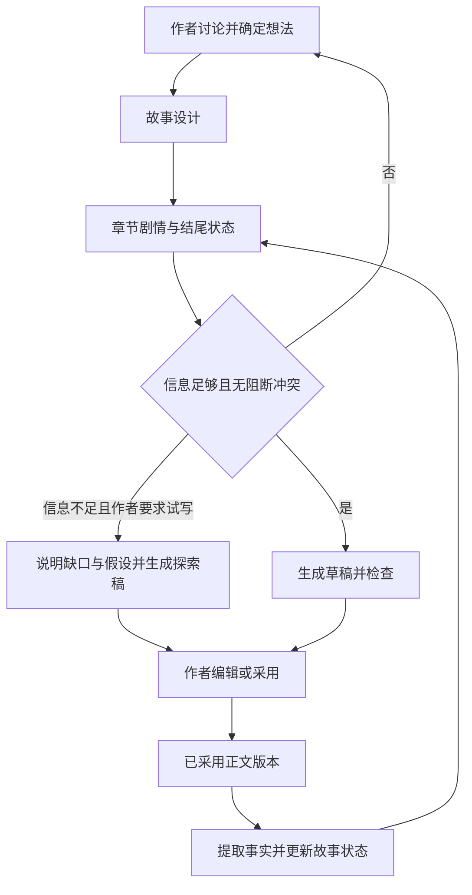

# 实施方案草案

本文为根据[需求基线](requirements.md)提出的工程方案。已确定先做 CLI，验证产品流程后再做 UI；建议采用 Python、Markdown 与 SQLite，模型供应商待定，尚未开始实现。

## 1. CLI 与用户路径

打开本地小说项目后进入持续对话，可以直接说“试写第一章”“这一版采用”“这一章已发布”。少量命令负责打开项目、查看状态、导出和恢复版本；具体命令语法在实现时确定。自然语言触发的状态变更也必须遵守作者权限与版本校验。

作者在讨论中采用想法后，内容进入对应故事设计；章节仍以“剧情”和“结尾状态”为核心。正文流式输出并保存为 Markdown，作者通过现有编辑器阅读全文与修改。终端展示新增设定、冲突、计划偏差和影响列表，支持重试与明确采用。

整章采用必须包含全文审阅，以及新增持久设定、既有决定冲突两类摘要。建议用明确的已读声明记录审阅，不能以滚动或计时声称作者读完；审阅关联正文版本，变更后重新审阅。已读声明的具体交互仍待确认。章节采用状态与发布状态独立显示。

建议支持整部小说备份与 Markdown 导出。后续 UI 复用创作逻辑与数据；桌面外壳、页面布局和云同步延后决定。

## 2. 最小系统结构

建议以 Python 实现 CLI 和创作逻辑，SQLite 保存讨论、决定、正文版本、事实来源与任务状态，Markdown 作为可外部编辑的正文工作副本。先接一个模型供应商。终端输入输出与核心逻辑分开，不预建服务框架。

CLI 阶段无需 FastAPI、PostgreSQL、桌面壳或云同步。探索、规划、写作、检查、事实提取由明确任务协调；先使用关系表、来源引用和章节摘要检索，验证不足后再评估向量检索等补充方案。

Markdown 工作副本的内容变化需在读取、生成和采用前检查；变化时保存新版本，使旧检查与相关派生状态失效。数据库中的已采用、已发布快照不能被外部编辑直接覆盖。生成期间文件变化时保留新旧结果，不覆盖作者编辑。

离线支持编辑、阅读和整理；模型生成需要联网。本地进程退出或电脑休眠后不保证继续生成，需保存部分输出与任务状态，重启后可检查或重试，不能宣称无缝续传。备份应同时包含正文和数据库。

## 3. 数据模型建议

| 对象 | 核心字段与职责 |
| --- | --- |
| Novel | 小说标识、作者、标题、写作规则 |
| Conversation / Message | 小说范围、发言方、正文、时间；保留原始讨论 |
| StoryItem | 类型、内容、来源消息、权威类别、状态、版本；覆盖角色、世界、剧情与伏笔 |
| ChapterPlan | 章节、剧情、结尾状态、计划版本、采用状态 |
| ChapterVersion | 章节序号、正文、父版本、分支、草稿或采用状态；关联审阅版本及发布版本记录 |
| Fact | 陈述、事实类别、相关实体、故事时间、正文版本与证据位置 |
| StateSnapshot | 分支、章节边界、来源版本集合、状态摘要、计算状态 |
| Change / Impact | 变更来源、受影响对象、原因、证据、处理状态 |
| GenerationRun | 任务类型、输入版本、状态、输出版本、错误、用量、作者委托的操作范围与来源 |

关系约束：所有对象属于小说；正式事实必须引用被采用正文版本；状态快照记录来源版本。作者确认变更时校验基础版本，避免覆盖编辑期间的新内容。

想法状态与信息权威分开存储：归档描述生命周期，作者决定描述修改权限，两者不能混成一个枚举。Canon 可由有来源的有效事实表达，不另建重复的正文真相副本。

## 4. AI 任务职责

| 任务 | 输入 | 输出及边界 |
| --- | --- | --- |
| 讨论 | 作者消息、相关上下文、明确委托范围 | 默认提供候选方案；明确委托内可选择并执行，不自动采用正文 |
| Ready 检查 | 章节剧情、结尾状态、相关决定与事实 | 可写或具体缺口；信息不足但作者要求试写时，携带缺口与假设生成探索稿 |
| 章节展开 | 已确定计划、状态与委托范围 | 展开叙事细节；持久设定默认先提议，不超范围新增决定 |
| 正文写作 | 计划、相关事实、作者规则 | 新草稿版本，不直接成为 Canon |
| 一致性检查 | 草稿、计划、引用上下文 | 有证据的问题列表与建议，不擅自重写 |
| 事实提取 | 正文版本及已有事实 | 候选事实、知识与状态变化，保留证据 |
| 影响分析 | 作者变更、依赖引用 | 受影响内容与原因，未知影响标为待检查 |

任务之间共享显式数据，不依赖模型“记住整个对话”。作者权限由应用校验，不能只靠提示词要求模型遵守。

## 5. 生成与采用的一致性

生成任务固定输入版本；若期间作者修改计划或正文，返回的稿件标为基于旧版本，不能覆盖新内容。任务支持取消和失败重试，已保存正文独立于生成请求保存。

生成任务区分正式写作与试写，试写记录缺口与假设，输出仍为未采用草稿。试写只放宽信息完整度，不放宽既有事实与修改权限。采用前同样执行检查、全文审阅和设定冲突审阅，明确作者采用的剧情与结尾状态；不自动把探索假设提升为事实。

采用流程：保存草稿 → 检查与候选提取 → 展示全文、新增持久设定、冲突与计划偏差 → 作者阅读全文并审阅 → 作者采用 → 校验基础版本 → 记录正式版本及有效事实。事务保存是工程建议。若提取失败，草稿仍可编辑；对作者直接修改的已采用正文，记录待重算状态并暂缓依赖旧状态的生成。

已采用正文决定实际故事状态，计划保留为历史意图；事实提取必须保留传闻、误判和不可靠叙述的语义。全文采用不等于模型提取结果永远正确，作者可从证据定位并纠正错误。

相同采用操作须幂等。版本回滚以新记录表达恢复，不删除历史。分支从明确版本起步；首期分支方案可采用完整快照复制，先保证隔离和可理解性，再根据真实规模优化存储。

## 6. 上下文与变更影响

每次写作构建可检查的上下文包：作者规则、章节计划、上一章状态、相关角色与世界规则、相关 Canon、未解决伏笔。每条信息保留出处与权威类别。故事内时间与章节顺序分开，支持倒叙和信息延迟揭露。

影响分析优先沿显式来源与对象引用查找，再用文本检索和模型分析补充。不能宣称找到了全部影响：展示已发现影响、证据与尚未检查范围。长篇规模与响应目标通过真实样本测量后确定。

未发布章节支持前章回改、后章待复核；只阻断依赖争议或过时事实的生成，不阻断无关工作。已发布章节默认进入后续补救讨论，保留发布版本与历史人物/读者认知；新解释采用后更新当前事实而不抹掉历史。补救方案也检查是否真正解释冲突，不能仅用“假死”等标签掩盖矛盾。

建议由作者手动标记具体版本已发布，不新增发布平台集成。修改已发布原文需要明确意图，记录本地修订与已发布版本差异，不自动声称外部平台同步成功。

## 7. 交付里程碑

| 阶段 | 可交付成果 | 验收出口 |
| --- | --- | --- |
| M0 需求定稿 | 确认 CLI 运行环境、采用交互与模型预算；准备代表性故事样本 | 关键待定项有记录 |
| M1 创作基础 | CLI 持续对话、本地项目、想法采用、故事设计、Markdown 外部编辑与版本保存 | A01、A18；重新打开内容不丢失 |
| M2 章节闭环 | 计划、Ready、试写与正式生成、全文审阅、检查、采用、事实与状态更新、范围委托 | A02–A05、A08、A09、A11、A12、A15–A17；完成连续三章 |
| M3 变更可靠性 | 发布状态、回改与后续补救、影响分析、回滚、分支隔离、伏笔追踪 | A06、A07、A10、A13、A14；前章修改能提示后章影响 |
| M4 完整 V1 | 时间线与阅读体验分析、长篇样本评估、导出与体验修正 | 覆盖 R01–R12，记录质量与成本结果 |

M2 是建议的首个可用闭环，不代表从 V1 中删除版本、分支或其他原需求。未获得实施指令前，本仓库仅交付文档。

先完整验证连续三章创作、修改未发布第一章并分析影响、标记第一章已发布并设计后续补救。CLI 验证产品流程后再启动 UI，UI 不作为上述阶段的交付条件。

## 8. 验证方法

确定性检查覆盖权限、版本引用、采用幂等性、分支隔离和失败保存。模型质量使用固定场景评估：越权反转、传闻误判、知识提前泄露、计划偏离和影响遗漏。重大剧情决定是否越权由人工样本审阅验证，不能用模型自评分作为唯一标准。

记录每章生成用时、模型用量、重试次数、作者采用情况与已知冲突。目标值待真实样本基线建立后确定，不预先承诺生成质量或长篇一致性百分比。

## 9. 开工前的范围选择

第一阶段为本地 CLI 创作验证，不引入云端账号系统。需确认支持的操作系统、模型供应商、预算与密钥配置方式。密钥保存在项目外的本地配置或环境变量，不进入仓库、正文导出或小说备份；发送给模型的内容限制为当前任务所需上下文。未来若提供多人云服务，再设计登录、隔离、配额和同步。
