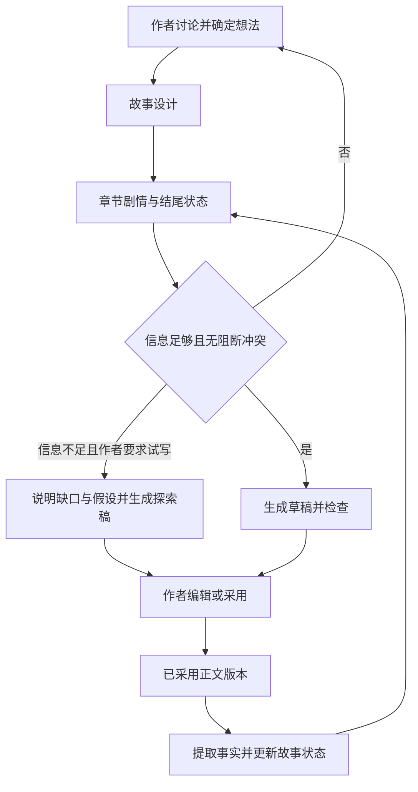

# 实施方案草案

本文为根据[需求基线](requirements.md)提出的工程方案。已确定先做 CLI，验证产品流程后再做 UI；建议采用 Python、Markdown 与 SQLite，模型供应商待定，尚未开始实现。已确定使用 uv 管理 Python 包与环境，使用 pytest 测试。

实现合同见[代码架构设计](code-architecture.md)，其中明确了数据表、接口、状态转换及验收落点。文件同步采用保守协议：已有外部工作副本不自动覆盖，新稿保存在数据库并可导出为独立文件，外部编辑按新版本导入。

代码架构 V0.2 按逻辑职责组织：交互入口调用应用用例，用例协调纯业务规则、AI 任务、上下文和基础设施。数据库事务、文件 I/O 与供应商通信分别拥有明确边界；原框架提案中的 workflow/store/model 是历史职责草图，现行接口与组织方式以代码架构第 2、4 节为准。

本文同时描述完整产品流程；发布命令、发布记录及已发布补救在 M3 实现，首个闭环不开放发布入口，下文相关描述不代表首期已有该功能。

## 1. CLI 与用户路径

打开本地小说项目后进入持续对话，可以直接说“试写第一章”“这一版采用”“这一章已发布”。少量命令负责打开项目、查看状态、导出和恢复版本；具体命令语法在实现时确定。自然语言触发的状态变更也必须遵守作者权限与版本校验。

作者在讨论中采用想法后，内容进入对应故事设计；章节仍以“剧情”和“结尾状态”为核心。正文流式输出并由系统保存为 Markdown；作者在 CLI 中阅读完整正文，通过普通多行文本编辑入口修改，提供明确的保存与取消提示，无需 Markdown 语法或手动定位文件。支持准确文字替换，匹配不唯一时先定位；外部编辑器作为可选能力。终端展示新增设定、冲突、计划偏差和影响列表，支持重试与明确采用。完整纸面样例见[三章创作走查](three-chapter-walkthrough.md)，编辑组件尚未选定或实现。

整章采用必须包含全文审阅，以及新增持久设定、既有决定冲突两类摘要。用作者明确的已读声明记录审阅，不能以滚动或计时声称作者读完；审阅关联正文版本，变更后重新审阅。采用前展示章节、版本和冲突处理结果，“这一版”只能指向当前明确展示的版本。章节采用状态与发布状态独立显示。

建议支持整部小说备份与 Markdown 导出。后续 UI 复用创作逻辑与数据；桌面外壳、页面布局和云同步延后决定。

## 2. 最小系统结构

建议以 Python 实现 CLI 和创作逻辑，SQLite 保存讨论、决定、正文版本、事实来源与任务状态，Markdown 作为可外部编辑的正文工作副本。先接一个模型供应商。终端输入输出与核心逻辑分开，不预建服务框架。

CLI 阶段无需 FastAPI、PostgreSQL、桌面壳或云同步。探索、规划、写作、检查、事实提取由明确任务协调；先使用关系表、来源引用和章节摘要检索，验证不足后再评估向量检索等补充方案。

Markdown 工作副本的内容变化需在读取、生成和采用前检查；变化时保存新草稿，使旧检查与审阅不能用于新草稿，草稿派生结果待更新；重新采用前，正式状态仍对应原已采用版本。数据库中的已采用、已发布快照不能被外部编辑直接覆盖。生成期间文件变化时保留新旧结果，不覆盖作者编辑。

离线支持编辑、阅读和整理；模型生成需要联网。本地进程退出或电脑休眠后不保证继续生成，需保存部分输出与任务状态，重启后可检查或重试，不能宣称无缝续传。备份应同时包含正文和数据库。

## 3. 数据模型建议

| 对象 | 核心字段与职责 |
| --- | --- |
| Novel | 小说标识、作者、标题、写作规则 |
| Conversation / Message | 小说范围、发言方、正文、时间；保留原始讨论 |
| StoryItem | 类型、内容、来源消息、权威类别、状态、版本；覆盖角色、世界、剧情与伏笔 |
| ChapterPlan | 章节、剧情、结尾状态、计划版本、采用状态 |
| ChapterVersion | 章节序号、正文、父版本、分支、草稿或采用状态；关联审阅版本及发布版本记录 |
| Fact | 陈述、事实类别、相关实体、故事时间、正文版本与证据位置 |
| StateSnapshot | 分支、章节边界、来源版本集合、状态摘要、计算状态 |
| Change / Impact | 变更来源、受影响对象、原因、证据、处理状态 |
| GenerationRun | 任务类型、输入版本、状态、输出版本、错误、用量、作者委托的操作范围与来源 |

关系约束：所有对象属于小说；正式事实必须引用被采用正文版本；状态快照记录来源版本。作者确认变更时校验基础版本，避免覆盖编辑期间的新内容。

想法状态与信息权威分开存储：归档描述生命周期，作者决定描述修改权限，两者不能混成一个枚举。Canon 可由有来源的有效事实表达，不另建重复的正文真相副本。

## 4. AI 任务职责

| 任务 | 输入 | 输出及边界 |
| --- | --- | --- |
| 讨论 | 作者消息、相关上下文、明确委托范围 | 默认提供候选方案；明确委托内可选择并执行，不自动采用正文 |
| Ready 检查 | 章节剧情、结尾状态、相关决定与事实 | 可写或具体缺口；信息不足但作者要求试写时，携带缺口与假设生成探索稿 |
| 章节展开 | 已确定计划、状态与委托范围 | 展开叙事细节；持久设定默认先提议，不超范围新增决定 |
| 正文写作 | 计划、相关事实、作者规则 | 新草稿版本，不直接成为 Canon |
| 一致性检查 | 草稿、计划、引用上下文 | 有证据的问题列表与建议，不擅自重写 |
| 事实提取 | 正文版本及已有事实 | 候选事实、知识与状态变化，保留证据 |
| 影响分析 | 作者变更、依赖引用 | 受影响内容与原因，未知影响标为待检查 |

任务之间共享显式数据，不依赖模型“记住整个对话”。作者权限由应用校验，不能只靠提示词要求模型遵守。

## 5. 生成与采用的一致性

生成任务固定输入版本；若期间作者修改计划或正文，返回的稿件标为基于旧版本，不能覆盖新内容。任务支持取消和失败重试，已保存正文独立于生成请求保存。

生成任务区分正式写作与试写，试写记录缺口与假设，输出仍为未采用草稿。试写只放宽信息完整度，不放宽既有事实与修改权限。采用前同样执行检查、全文审阅和设定冲突审阅，明确作者采用的剧情与结尾状态；不自动把探索假设提升为事实。

采用流程：保存草稿 → 检查与候选提取 → 展示全文、新增持久设定、冲突与计划偏差 → 作者阅读全文并审阅 → 作者采用 → 校验基础版本 → 保存采用记录并标记状态待更新 → 完成事实与状态重算。采用记录和待更新标记应在同一数据库事务中保存；模型调用不放进事务。采用前检查或候选提取失败时保留草稿，重试完成审阅材料后再采用；采用后重算失败时保留采用结果，恢复流程只重算派生数据。

已采用正文决定实际故事状态，计划保留为历史意图；事实提取必须保留传闻、误判和不可靠叙述的语义。全文采用不等于模型提取结果永远正确，作者可从证据定位并纠正错误。

相同采用操作须幂等。版本回滚以新记录表达恢复，不删除历史。分支从明确版本起步；首期分支方案可采用完整快照复制，先保证隔离和可理解性，再根据真实规模优化存储。

### 5.1 版本与状态的含义

以下为 2026-09-09 补充的操作设计，用于首个原型实现与验收；不代表模型质量已经得到验证。

- 正文版本保存不可覆盖的内容；外部文件是工作副本。保存、采用、发布是三个独立动作。
- 每章当前采用记录指向一个明确版本；发布记录保留读者实际看到的版本，不随本地重新采用而移动。
- 检查与审阅绑定正文版本、计划版本及所用上下文依据。任何相关依据变化后，需要重新检查并展示差异，旧审阅不能直接授权新的采用。
- 正式状态按章节边界保存，记录来源正文版本和事实修订依据。只有与当前依据匹配且计算完成的状态可标为最新。
- 采用后重算复用已审阅的候选提取与作者修订；若发现新的持久设定或冲突，记录为待处理问题，不能借重算获得新的设定授权。
- “待复核”表示后续内容可能受影响；“状态待更新”表示派生数据尚不可用。两者不混为一个状态，也不阻止阅读和保存草稿。
- 前文变化后，已采用的后章若正文不变，重新检查并记录复核依据、重算相关状态即可；无需创建新正文或重复采用。若发现需作者裁决的问题，继续保留待复核。旧审阅不能授权新采用，不等于历史采用记录失效。

### 5.2 操作与状态转换表

| 操作 / 触发 | 前提与版本校验 | 持久化结果 | 后续允许的操作与失败处理 |
| --- | --- | --- | --- |
| 正式写作或试写 | 固定计划、上下文和委托范围；试写记录缺口与假设 | 新草稿及生成任务；不产生采用记录 | 可编辑、检查、丢弃；超时或取消保留已保存的部分输出，标记未完成 |
| 保存或发现外部编辑 | 比较工作副本与上次记录的内容 | 有变化才保存新草稿版本；保留原采用与发布记录 | 新草稿重新检查；不改变正式故事状态 |
| 检查与候选提取 | 固定草稿、计划和上下文依据 | 带出处的新增设定、冲突、偏差和候选事实 | 失败可重试，不能把缺失结果显示为“无问题”；依据变化则结果过时 |
| 全文审阅 | 展示完整正文及完整检查结果，指明版本 | 已读声明、设定与冲突处理记录 | 可采用该版本；编辑正文或改变相关依据后重新检查与审阅 |
| 采用 | 审阅对应当前目标版本；检查依据未变；需授权的变更已明确授权 | 在同一事务中更新采用记录并标记相关状态待更新；保留原计划与偏差 | 重复提交返回同一采用结果；基础版本变化则不采用，提示重新检查 |
| 重算正式事实与状态 | 使用已采用版本和当前事实修订依据 | 完成后一次提交匹配依据的事实与状态；旧结果保留为历史 | 失败仍待更新，可重试；计算期间依据变化则结果不能成为最新 |
| 重新采用前章 | 沿用同样的检查、审阅与采用规则 | 更新该章采用记录，标记后续依赖状态过时，相关章节待复核 | 不改后章正文；影响范围未查明时不能宣称后章无关 |
| 恢复历史版本 | 指定章节和历史版本 | 创建引用历史内容的新恢复记录，保留现有历史 | 先作为草稿；恢复为正式正文仍走采用流程，并重算受影响状态 |
| 标记发布 | 作者指定已采用的准确版本 | 独立发布记录 | 后续本地修改不改变发布记录；修改已发布原文必须明确该意图 |
| 纠正事实提取 | 作者指出原文证据及错误解释 | 保存提取修订记录，使依赖状态待更新；不改正文 | 同一版本重算时沿用修订；若其实需要改正文，进入新草稿流程 |

生成前若存在前章未采用修改，明确显示本次仍依据哪个已采用版本，不把草稿混入正式上下文。采用后状态待更新时，依赖该状态的生成暂停，试写也不能绕过；可继续阅读、编辑、讨论和经确认无关的工作。作者指定历史依据时保存为显式的历史上下文任务，结果仍是草稿，不能冒充基于当前状态的续写或跳过采用前检查。

### 5.3 冲突与作者决定

模型给出问题与证据，应用执行版本和授权规则。问题按以下方式处理，不用一个“有冲突”标记全部阻断：

| 问题类型 | 作者可以如何处理 | 对采用和续写的约束 |
| --- | --- | --- |
| 疑似矛盾、提取误判 | 查看证据，修正文稿、纠正提取或记录理由后保留疑问 | 可带未解决疑问采用；依赖争议解释的后续生成须先明确依据 |
| 有意保留的悬念、传闻或不可靠叙述 | 标明这是叙事安排，保留谁知道、谁相信及出处 | 不强行确定世界真相；续写保留信息差 |
| 新增持久设定、改变既有作者决定 | 明确接受具体设定或授权具体变更，或修改草稿 | 普通已读声明不等于变更授权；未处理前不采用 |
| 与既有正文直接冲突 | 修改当前草稿、回改未发布前章，或设计后续解释 | 不能靠“忽略”覆盖 Canon；补救计划未成文并采用前仍只是计划 |
| 结尾偏离原计划 | 改正文，或明确接受实际结果 | 接受后按正文计算状态，保留原计划和偏差记录 |
| 检查缺失、审阅过时、版本不匹配 | 重试检查或重新审阅指定版本 | 暂不采用；这是操作依据不足，不是模型对剧情质量的否决 |

### 5.4 三个端到端验收流程

以下为待执行的验收脚本，当前尚未实现应用。每步检查保存记录与引用关系，不能仅凭模型回复“已完成”通过验收。

| 流程 | 操作 | 必须观察到的结果 |
| --- | --- | --- |
| 连续三章：第一章 | 输入“调查旧井”，结尾“看到疑似师父的尸体”；生成、阅读全文并采用 v1 | 存在精确的审阅与采用引用；不能仅由尸体推断师父确实死亡；状态完成后才能供续写使用 |
| 连续三章：第二章 | 生成含新开锁能力的草稿，拒绝该版本后重写；审阅并采用新稿 | 开锁能力出现在新增设定检查中；拒绝稿不进入正式事实；下一章上下文只使用采用稿 |
| 连续三章：第三章 | 信息不足时请求试写，查看假设；编辑后尝试沿用旧审阅，再重新检查并采用 | 试写不被补表阻断；旧审阅不能采用编辑后的版本；正式状态对应最终版本，探索假设不自动成为事实 |
| 回改第一章：保存 | 在上述三章基础上外部编辑第一章，增加“尸体手腕没有师父的旧伤” | 保存新草稿；原采用和发布记录不变，正式状态仍对应旧正文；新草稿旧检查失效 |
| 回改第一章：采用 | 审阅并重新采用第一章，检查后章中有关确认身份的内容 | 第一章状态重算；相关后章待复核并列出证据，后章原文不变；依赖身份判断的生成不能使用过时状态 |
| 回改第一章：恢复 | 将第一章恢复为旧内容并重新采用 | 历史不被删除；采用指向新的恢复记录；重算到对应依据，不能只把旧状态标签改成最新 |
| 提取失败：采用前 | 注入候选提取超时，重启后重新打开草稿并重试 | 全文仍在；检查显示未完成；尚未采用；重试成功后才能完成审阅与采用 |
| 提取失败：采用后 | 完成采用后让正式状态重算失败，再重启与重试 | 采用版本仍在、状态待更新；依赖续写暂停；重试不会重复采用，成功后状态引用准确版本 |
| 提取失败：重试中变更 | 重算期间重新采用一个更新版本，让旧任务随后返回 | 旧任务结果不能发布为当前状态；更新版本仍待正确重算，不覆盖正文或采用记录 |

这三个流程验证操作可靠性，不证明长篇创作质量。另准备一份作者熟悉的较长故事样本，记录章节数、字数和已知事实，人工核对上下文遗漏、人物知识泄露、影响遗漏及每章成本；目标整书规模和质量阈值仍待样本基线确定。

## 6. 上下文与变更影响

每次写作构建可检查的上下文包：作者规则、章节计划、上一章状态、相关角色与世界规则、相关 Canon、未解决伏笔。每条信息保留出处与权威类别。故事内时间与章节顺序分开，支持倒叙和信息延迟揭露。

影响分析优先沿显式来源与对象引用查找，再用文本检索和模型分析补充。不能宣称找到了全部影响：展示已发现影响、证据与尚未检查范围。长篇规模与响应目标通过真实样本测量后确定。

未发布章节支持前章回改、后章待复核；只阻断依赖争议或过时事实的生成，不阻断无关工作。已发布章节默认进入后续补救讨论，保留发布版本与历史人物/读者认知；新解释采用后更新当前事实而不抹掉历史。补救方案也检查是否真正解释冲突，不能仅用“假死”等标签掩盖矛盾。

建议由作者手动标记具体版本已发布，不新增发布平台集成。修改已发布原文需要明确意图，记录本地修订与已发布版本差异，不自动声称外部平台同步成功。

## 7. 交付里程碑

| 阶段 | 可交付成果 | 验收出口 |
| --- | --- | --- |
| M0 需求定稿 | 确认 CLI 运行环境、采用交互与模型预算；准备代表性故事样本 | 关键待定项有记录 |
| M1 创作基础 | CLI 持续对话、本地项目、想法采用、故事设计、普通正文编辑、可选 Markdown 外部编辑与版本保存 | A01、A18、A19；重新打开内容不丢失 |
| M2 章节闭环 | 计划、Ready、试写与正式生成、全文审阅、检查、采用、事实与状态更新、范围委托 | A02–A05、A08、A09、A11、A12、A15–A17；完成连续三章 |
| M3 变更可靠性 | 发布状态、回改与后续补救、影响分析、回滚、分支隔离、伏笔追踪 | A06、A07、A10、A13、A14；前章修改能提示后章影响 |
| M4 完整 V1 | 时间线与阅读体验分析、长篇样本评估、导出与体验修正 | 覆盖 R01–R12，记录质量与成本结果 |

首个可用闭环以 M2 为主，同时包含第 5 节的版本恢复、前章重新采用后的过时状态保护和失败重试；这些基础可靠性规则不能推迟到 M3。完整影响分析、发布补救、分支和伏笔追踪仍在 M3，不代表从 V1 删除。未获得实施指令前，本仓库仅交付文档。

先完整验证连续三章创作、修改未发布第一章并分析影响、标记第一章已发布并设计后续补救。CLI 验证产品流程后再启动 UI，UI 不作为上述阶段的交付条件。

## 8. 验证方法

确定性检查覆盖权限、版本引用、采用幂等性、分支隔离和失败保存。模型质量使用固定场景评估：越权反转、传闻误判、知识提前泄露、计划偏离和影响遗漏。重大剧情决定是否越权由人工样本审阅验证，不能用模型自评分作为唯一标准。

记录每章生成用时、模型用量、重试次数、作者采用情况与已知冲突。目标值待真实样本基线建立后确定，不预先承诺生成质量或长篇一致性百分比。

## 9. 开工前的范围选择

第一阶段为本地 CLI 创作验证，不引入云端账号系统。需确认支持的操作系统、模型供应商、预算与密钥配置方式。密钥保存在项目外的本地配置或环境变量，不进入仓库、正文导出或小说备份；发送给模型的内容限制为当前任务所需上下文。未来若提供多人云服务，再设计登录、隔离、配额和同步。
